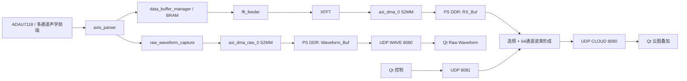

# 局部放电声学成像系统技术文档

> 适用工程：`ZYNQ_7020_yuntu`  
> 平台：Zynq-7020，64 通道声学阵列，FPGA 频域定位，Qt 上位机  
> 文档版本：V1.0  
> 更新日期：2026-07-29

## 1. 文档目的

本文档描述当前局部放电声学成像系统的实际工程实现，用于开发、部署、联调、定位算法优化和故障排查。内容以工程中的 RTL、Block Design、板端 C 程序和 Qt 上位机代码为准。

系统具备两项核心能力：

1. 使用 64 通道阵列的 FFT 复数结果进行二维波束形成，输出定位云图。
2. 从 FFT 前的数据通路采集通道 0 的**真实原始时域采样**，通过 UDP 在 Qt 上位机中绘制波形。

原始时域波形不是由 FFT 频谱反变换得到，而是直接来自 `axis_parser` 输出的 `frame_data`。这条结论对调试很重要：波形能用于判断采集前端、数据格式、幅度、削顶和脉冲形态是否正常。

---

## 2. 系统功能与边界

### 2.1 系统目标

- 对 64 路同步声学采样数据进行帧级处理。
- 在可设置频段中选择有效频点。
- 使用预先生成的距离表执行二维延时求和波束形成。
- 输出 `41 x 41` 网格的能量图，并压缩为 `32 x 24` UDP 云图。
- 支持单源和双源定位模式。
- 在上位机叠加显示相机画面、声学云图、主频和原始时域波形。

### 2.2 系统不保证的能力

以下能力目前没有由代码自动完成，使用时不能作出超出系统实现的解释：

- 云图峰值不是绝对声压或局部放电量。
- 当前未输出已标定的物理坐标、三维坐标或定位置信度。
- 相机画面与阵列坐标的外参/内参标定不在本工程中自动完成。
- `dist.bin` 的阵列坐标、扫描区域和单位由离线生成过程决定，本文不假设其具体物理尺寸。
- 当前仅发送通道 0 的 128 点时域片段，不是 64 通道连续录音系统。

---

## 3. 关键参数

| 项目 | 当前值 | 说明 |
|---|---:|---|
| 阵列通道数 | 64 | 定位使用全部通道的 FFT 复数观测值。 |
| 单帧点数 | 128 | FFT 长度和原始时域波形长度。 |
| 采样率 | 192000 Hz | 奈奎斯特频率为 96 kHz。 |
| 频率分辨率 | 1500 Hz | `192000 / 128`。频点 `b` 对应 `b x 1500 Hz`。 |
| 可用 FFT bin | 1 至 63 | DC bin 0 不参与定位。候选峰搜索当前限制为 2 至 62。 |
| 默认搜索频段 | 1 kHz 至 96 kHz | 上位机可通过 UDP 运行时修改。 |
| 声速 | 343.0 m/s | 波束形成使用的固定值，应按现场温度校正。 |
| 原始扫描网格 | 41 x 41 | 共 1681 个扫描点。 |
| 网络云图 | 32 x 24 | 共 768 个 8 位强度点。 |
| 单源候选频点数 | 最大 6 | 多个频点的能量图叠加。 |
| 多源候选频点数 | 最大 2 | 第二峰低于主峰功率 15% 时不渲染。 |
| 时域波形通道 | 硬件通道 0 | 当前不可由上位机切换。 |
| 时域波形长度 | 128 x `int16_t` | 192 kHz 下时间跨度约 0.667 ms。 |
| WAVE UDP 负载 | 268 字节 | 报头 12 字节 + 128 个 16 位样本。 |

主 FFT DMA 的帧大小为：

```text
64 通道 x 128 点 x 8 字节 = 65536 字节
```

其中每个 64 位 FFT 数据字按软件约定解释为：低 24 位有符号实部，高 24 位有符号虚部。

---

## 4. 总体架构



### 4.1 两条数据路径

| 路径 | 输入点 | 数据内容 | 目的 | 是否影响原定位 DMA |
|---|---|---|---|---|
| 频域定位路径 | XFFT 输出 | 64 通道 x 128 点复数频谱 | 选频、波束形成、云图 | 是，主路径 |
| 原始时域旁路 | `axis_parser.frame_data` | 通道 0 x 128 点 signed int16 | 显示真实原始波形 | 否，独立 DMA |

时域旁路刻意不复用原 FFT DMA。这样新增波形功能不会改变 FFT 输入、FFT 输出格式、主定位 DMA 缓冲区或 CLOUD 协议。

---

## 5. FPGA 数据通路

### 5.1 `axis_parser`：64 通道帧组装

文件：`AXI_DMA.srcs/sources_1/new/axis_parser.v`

`axis_parser` 接收连续 AXI Stream 输入，在内部累积 8 个传输节拍后输出一次完整的 1024 位 `frame_data`，并将 `frame_valid` 拉高一个时钟周期。

```verilog
// 64 通道 x 16 bit = 1024 bit
output reg           frame_valid;
output reg [1023:0]  frame_data;
```

通道 `n` 的原始采样在 `frame_data` 中的位置为：

```verilog
frame_data[n * 16 +: 16]
```

因此通道 0 的原始采样为：

```verilog
frame_data[15:0]
```

该位置在 FFT 之前，是本次原始时域波形扩展的取数点。

### 5.2 原有 FFT 定位路径

| 模块 | 文件 | 职责 |
|---|---|---|
| `axis_parser` | `axis_parser.v` | 将输入数据整理为 64 通道并行瞬时帧。 |
| `data_buffer_manager` | `data_buffer_manager.v` | 缓存和协调帧数据的下游使用。 |
| BRAM | Block Design IP | 保存待 FFT 的帧级采样数据。 |
| `fft_feeder` | `fft_feeder.v` | 以 FFT IP 所需的时序和格式提供采样数据。 |
| XFFT | Vivado IP | 执行 128 点 FFT，输出复数频谱。 |
| `axi_dma_0` | Block Design IP | 将 FFT 输出经 S2MM 写入 PS 可访问的 DDR。 |

### 5.3 新增 `raw_waveform_capture`

文件：`AXI_DMA.srcs/sources_1/new/raw_waveform_capture.v`

该模块实现如下功能：

1. 每次 `frame_valid` 到来时，从 `frame_data` 中取指定通道的 16 位样本。
2. 连续保存 128 个样本到 `sample_mem[0:127]`。
3. 将 4 个 16 位样本打包为一个 64 位 AXI Stream 数据拍。
4. 连续输出 32 个 AXI Stream 数据拍。
5. 最后一拍时置位 `TLAST`。

关键接口：

| 信号 | 方向 | 位宽 | 说明 |
|---|---|---:|---|
| `clk` | 输入 | 1 | PL 处理时钟。 |
| `rst_n` | 输入 | 1 | 低有效复位。 |
| `frame_valid` | 输入 | 1 | `axis_parser` 输出的帧有效信号。 |
| `frame_data` | 输入 | 1024 | 64 个 16 位原始采样。 |
| `m_axis_wave_tdata` | 输出 | 64 | 4 个时域样本打包。 |
| `m_axis_wave_tvalid` | 输出 | 1 | AXI Stream 数据有效。 |
| `m_axis_wave_tready` | 输入 | 1 | 新 DMA 的接收就绪。 |
| `m_axis_wave_tlast` | 输出 | 1 | 第 32 个 64 位字的帧结束标志。 |

打包顺序为：

```verilog
m_axis_wave_tdata = {
    sample_mem[sample_base + 3],
    sample_mem[sample_base + 2],
    sample_mem[sample_base + 1],
    sample_mem[sample_base]
};
```

因为 ARM 和当前 Qt 都按小端 `int16_t` 数组读取 DMA/UDP 内容，所以该打包在现有链路中与 `int16_t samples[128]` 的内存顺序匹配。

### 5.4 时域旁路的帧行为

当 128 点采集完成后，模块仅在 `stream_active == 0` 时启动一次输出。这意味着 DMA 未准备好时，模块保留最近完成的一帧，不会向上游施加反压，也不会中断 FFT 主路径。

这种设计适合：

- 确认采集是否有信号。
- 观察脉冲、削顶、直流偏置和噪声形态。
- 在上位机进行低速诊断显示。

这种设计不适合：

- 无丢失连续录音。
- 大容量历史回放。
- 同时传输 64 通道全部原始采样。

### 5.5 新增 DMA 与 Block Design 连接

Block Design 新增：

- `raw_waveform_capture_0`
- `axi_dma_raw_0`
- `raw_waveform_lite_reset_0`

连接关系：

```text
axis_parser_0/frame_valid  -> raw_waveform_capture_0/frame_valid
axis_parser_0/frame_data   -> raw_waveform_capture_0/frame_data
raw_waveform_capture_0/m_axis_wave -> axi_dma_raw_0/S_AXIS_S2MM
axi_dma_raw_0/M_AXI_S2MM   -> axi_smc/S02_AXI -> PS HP0 DDR
ps7_0_axi_periph/M01_AXI  -> axi_dma_raw_0/S_AXI_LITE
```

DMA 配置：

| 属性 | 当前设置 |
|---|---|
| MM2S | 禁用 |
| S2MM | 启用 |
| Scatter-Gather | 禁用 |
| S2MM DRE | 启用 |
| S2MM M_AXI 数据位宽 | 64 位 |
| S2MM 突发长度 | 32 |

时钟和复位：

- 时域采样数据路径和新 DMA 数据端使用 `clk_wiz_0/clk_out1`。
- 新 DMA 的 AXI-Lite 控制端使用 `processing_system7_0/FCLK_CLK0`。
- 新增 `raw_waveform_lite_reset_0`，向 AXI-Lite 时钟域提供同步复位，避免复位跨时钟域问题。

连接脚本：`scripts/enable_raw_waveform_capture.tcl`

该脚本会执行 `validate_bd_design` 并保存 `System.bd`。当前工程的 Block Design 已完成校验。

---

## 6. PS 端软件设计

主程序：`AXI_DMA.sdk/AXI_DMA_Test/src/main.c`

### 6.1 启动流程

1. 初始化 GIC、中断、主 FFT DMA。
2. 若 BSP 含 `XPAR_AXI_DMA_RAW_0_DEVICE_ID`，初始化原始时域 DMA。
3. 初始化正弦查表 `sine_lut[4096]`。
4. 从 SD 卡加载 `dist.bin` 到 `dist_table`。
5. 初始化 lwIP、网卡和 UDP。
6. 等待上位机通过 UDP 发送 START。

如果 SD 卡上未找到 `dist.bin`，程序打印错误后返回，系统不会进入可定位状态。这是“完全没有定位结果”时必须优先检查的项。

### 6.2 主定位循环

```text
while (1) {
    处理 lwIP 网络输入；

    若 is_locating == 1：
        为 axi_dma_0 提交 FFT S2MM 接收；
        等待 RxDone 或 Error；

        若主 DMA 成功：
            单源或多源选频；
            提取 64 通道观测向量；
            执行波束形成；
            发送 CLOUD UDP；
            轮询 raw DMA，并在完成时发送 WAVE UDP；
}
```

当前时域 DMA 的服务函数在主 FFT 帧成功处理后调用。因此：

- 未点击 START 时不会稳定发送 WAVE。
- 主 FFT DMA 出错时不会保证发送 WAVE。
- WAVE 帧率受 CPU 波束形成耗时和主定位循环帧率影响。

### 6.3 缓冲区和缓存维护

| 缓冲区 | 定义 | 大小 | 用途 |
|---|---|---:|---|
| `RX_Buf` | `uint64_t RX_Buf[64 x 128]` | 65536 B | 存放 FFT DMA 结果。 |
| `Waveform_Buf` | `int16_t Waveform_Buf[128]` | 256 B | 存放原始时域 DMA 结果。 |
| `dist_table` | `float[1681 x 64]` | 约 430 kB | 每个网格点至每个通道的距离。 |
| `energy_map` | `float[1681]` | 约 6.6 kB | 波束形成后的能量图。 |
| `obs_vector` | `ComplexFloat[64]` | 512 B | 当前频点的阵列观测向量。 |

DMA 提交前、完成后都调用 `Xil_DCacheInvalidateRange`。如果缓存操作遗漏，CPU 可能读取到旧数据，表现为云图不变化、波形延迟或波形恒定。

### 6.4 条件编译与 BSP

原始波形代码使用以下条件编译：

```c
#ifdef XPAR_AXI_DMA_RAW_0_DEVICE_ID
    init_raw_wave_dma();
    service_raw_wave_dma();
#endif
```

含义：

- 旧 BSP 仍可编译并继续发送云图。
- 旧 BSP 不会发送任何 WAVE 报文。
- 只有新的 HDF/XSA 被 SDK 导入、BSP 重新生成、`xparameters.h` 中生成了 `XPAR_AXI_DMA_RAW_0_DEVICE_ID` 后，时域功能才会实际编进 ELF。

---

## 7. 定位算法

### 7.1 FFT 数据解释

每个通道每个频点的 64 位数据按下列方式读取：

```c
uint64_t raw = RX_Buf[hw_ch * POINTS_PER_FRAME + bin];
int32_t re_i = (int32_t)(raw & 0xFFFFFF);
int32_t im_i = (int32_t)((raw >> 24) & 0xFFFFFF);

if (re_i & 0x800000) re_i |= 0xFF000000;
if (im_i & 0x800000) im_i |= 0xFF000000;
```

硬件通道序号随后映射为实际阵列通道：

```c
line_idx = hw_ch % 8;
slot_idx = hw_ch / 8;
real_ch = line_idx * 8 + slot_idx;
```

`real_ch` 必须与 `dist.bin` 生成时的通道顺序一致。通道重排错误会产生热点镜像、旋转、漂移或完全散乱，是定位不准的高优先级根因。

### 7.2 为什么只选择单通道峰值会导致定位失败

若频点只由 0 号通道的峰值决定，会出现以下问题：

- 局放声源到不同阵元的幅度不一致，0 号通道可能刚好较弱。
- 单通道可能处在方向性衰减、接触不良或异常噪声位置。
- 局放通常是宽带脉冲，不一定形成尖锐的单频峰。
- 单通道噪声峰可能被误认为信号频点。

因此，定位频点应依赖阵列整体能量，而不是某一路的偶然峰值。

### 7.3 当前全阵列选频策略

当前实现的频点功率为 64 通道平均功率：

```text
P(b) = (1 / 64) x sum(|X_ch(b)|^2)
     = (1 / 64) x sum(re_ch(b)^2 + im_ch(b)^2)
```

`find_top_n_bins()` 的过程：

1. 根据上位机设置的频段计算起止 bin。
2. 计算该频段内每个 bin 的全阵列平均功率。
3. 计算频段平均功率 `mean_pwr`。
4. 设定自适应门限：`adaptive_threshold = mean_pwr x 1.15`。
5. 保留同时满足自适应门限和局部极大值条件的 bin。
6. 按功率从高到低排序。
7. 如果宽带局放没有严格局部峰，强制回退到频段内最强 bin。

因此，当前代码已经避免了“没有严格峰值就完全不定位”的问题。

单源模式使用最多 6 个候选 bin；多源模式使用最多 2 个候选 bin。多源模式中，第二候选功率低于第一个候选功率的 15% 时不参与渲染。

### 7.4 统一归一化，而不是逐通道归一化

波束形成依赖通道间的相对幅度和相位。当前实现先求整个阵列的功率，再对所有通道使用同一个比例因子：

```text
total_pwr = sum_ch(|X_ch|^2)
scale = sqrt(64 / total_pwr)
X'_ch = scale x X_ch
```

这样做的目的：

- 抑制不同帧总体信号幅度变化。
- 保留通道之间的相对幅度。
- 保留通道之间的相对相位。

不应对每个通道单独归一化。逐通道归一化会把弱通道噪声放大到与强通道相近的等级，同时消除空间方向图中的幅度差异，容易导致热点漂移、分裂或没有稳定主峰。

### 7.5 延时求和波束形成

对扫描网格点 `g` 和频率 `f`：

```text
k = 2 x pi x f / c
S(g, f) = sum_ch X_ch(f) x exp(j x k x d(g, ch))
E(g) = E(g) + |S(g, f)|^4
```

其中：

- `c = 343.0 m/s`。
- `d(g, ch)` 来自 `dist_table`，即 `dist.bin` 加载后的距离表。
- 单源模式对多个候选频点的 `E(g)` 做累积。
- 正弦和余弦由 4096 点查表近似，以降低 ARM 计算负担。

### 7.6 定位结果的含义

`energy_map` 中能量最高的网格点表示：在当前频点、当前距离表、当前声速和当前通道相位关系下，最符合该扫描点传播模型的位置。

它不是直接测得的物理坐标。若阵列几何、通道顺序、声速、采样延时或 `dist.bin` 不正确，能量图仍然可以出现热点，但热点位置没有物理可信度。

---

## 8. UDP 通信协议

### 8.1 网络配置

| 端点 | 地址 | 说明 |
|---|---|---|
| Zynq 板端 IP | `192.168.1.10` | 板端静态地址。 |
| 上位机目标 IP | `192.168.1.12` | 板端 CLOUD/WAVE 发送目标。 |
| 数据端口 | UDP `8080` | 板端发送，Qt 接收。 |
| 控制端口 | UDP `8081` | Qt 发送，板端接收。 |

PC 网卡应与板端位于同一网段，例如：

```text
IP:      192.168.1.12
Mask:    255.255.255.0
Gateway: 192.168.1.1 或按实际网络设置
```

### 8.2 CLOUD 云图数据报

发送结构体：

```c
typedef struct {
    uint32_t magic;
    float peak_freq;
    float peak_pwr;
    uint8_t grid[32 * 24];
} __attribute__((packed)) CloudPacket_t;
```

总长度：`4 + 4 + 4 + 768 = 780` 字节。

| 偏移 | 字段 | 类型 | 长度 | 说明 |
|---:|---|---|---:|---|
| 0 | `magic` | `uint32_t` | 4 | 固定 `0x5A5AA5A5`。 |
| 4 | `peak_freq` | `float` | 4 | 主候选频率，单位 Hz。 |
| 8 | `peak_pwr` | `float` | 4 | 当前帧能量图的最大能量。 |
| 12 | `grid` | `uint8_t[768]` | 768 | 32 x 24 相对能量，范围 0 至 255。 |

PS 端将 `41 x 41` 的 `energy_map` 抽样为 `32 x 24`：

```c
src_x = (x * 40) / 31;
src_y = (y * 40) / 23;
```

随后按当前帧最大能量归一化到 0 至 255。该设计有利于突出每一帧热点位置，但不同帧的颜色值不能直接代表绝对强度变化。

### 8.3 WAVE 原始时域数据报

发送结构体：

```c
typedef struct {
    uint32_t magic;
    float sampling_rate;
    uint16_t channel;
    uint16_t sample_count;
    int16_t samples[128];
} __attribute__((packed)) WavePacket_t;
```

总长度：`4 + 4 + 2 + 2 + 256 = 268` 字节。

| 偏移 | 字段 | 类型 | 长度 | 说明 |
|---:|---|---|---:|---|
| 0 | `magic` | `uint32_t` | 4 | 固定 `0x57415645`，ASCII 为 `WAVE`。 |
| 4 | `sampling_rate` | `float` | 4 | 当前为 `192000.0` Hz。 |
| 8 | `channel` | `uint16_t` | 2 | 当前固定为 `0`。 |
| 10 | `sample_count` | `uint16_t` | 2 | 当前固定为 `128`。 |
| 12 | `samples` | `int16_t[128]` | 256 | FFT 前真实原始时域样本。 |

当前协议直接按小端内存布局发送。Zynq ARM 与 Windows x86/x64 Qt 均为小端，因此当前实现可直接使用 `memcpy`。若将来与其他字节序平台互联，应显式规定并转换字节序。

### 8.4 控制命令

| 命令 | 报文长度 | 布局 | 板端行为 |
|---|---:|---|---|
| 单源模式 | 4 | `uint32_t 0` | `MODE_SINGLE_SOURCE`。 |
| 多源模式 | 4 | `uint32_t 1` | `MODE_MULTI_SOURCE`。 |
| 开始定位 | 4 | `uint32_t 2` | `is_locating = 1`。 |
| 停止定位 | 4 | `uint32_t 3` | `is_locating = 0`。 |
| 设置频段 | 12 | `uint32_t 4 + float min_kHz + float max_kHz` | 更新频段。 |

频段限制：

```text
min >= 1.0 kHz
max <= 96.0 kHz
min < max
```

---

## 9. Qt 上位机设计

主要文件：

- `pc_app_qt/AcousticMainWindow.h`
- `pc_app_qt/AcousticMainWindow.cpp`

### 9.1 主要组件

| 组件 | 实现 | 功能 |
|---|---|---|
| 相机显示 | `QCameraViewfinder` | 显示现场图像。 |
| 云图层 | `AcousticOverlayWidget` | 叠加热力图与状态信息。 |
| UDP 接收 | `QUdpSocket` | 监听 UDP 8080。 |
| 网络刷新 | `QTimer`，30 ms | 读取待接收数据报并刷新显示。 |
| 时域波形 | `TimeWaveformWidget` | 绘制 128 点 signed int16 波形。 |
| 波形容器 | `QDockWidget` | 底部可停靠 `Raw Waveform` 面板。 |

### 9.2 CLOUD 和 WAVE 的并行解析

上位机在一次 `updateNetwork()` 调用中读取全部等待的数据报，分别保留最新 CLOUD 和最新 WAVE 报文。这样即使网络短时堆积，也优先显示当前状态而不是滞后地逐包渲染。

解析条件：

```text
CLOUD: 长度必须为 780，magic 必须为 0x5A5AA5A5
WAVE:  长度必须为 268，magic 必须为 0x57415645
```

### 9.3 原始时域波形显示

`TimeWaveformWidget` 的显示规则：

- 横轴：从 0 到 `128 / sampling_rate` 秒。
- 192 kHz 时右端显示约 `0.667 ms`。
- 纵轴：使用本帧最大绝对值自适应缩放。
- 为避免量程频繁变化，幅度上限向上取整到 256 的倍数。
- 显示通道编号和正负满幅参考值。

波形控件不做滤波、整流、FFT 或反变换。显示曲线即收到的 `int16_t` 原始样本。

### 9.4 界面操作与板端对应关系

| 上位机操作 | 发送命令 | 板端预期行为 |
|---|---|---|
| `PREVIEW Start` | 先发频段命令，再发 START | 开始主 DMA、定位、CLOUD 和 WAVE 服务。 |
| `STOP` | 命令 3 | 停止下一轮定位处理。 |
| Min/Max(kHz) | 命令 4 | 改变候选频点搜索范围。 |
| 场景 `PD` | 设置 1 至 96 kHz | 用于局放的宽频初始扫描。 |
| Raw Waveform 面板 | 不发送命令 | 仅显示板端收到且发出的 WAVE。 |

注意：界面中的 `Threshold`、`X Offset` 和 `Y Offset` 当前用于上位机显示状态或视觉叠加，并不直接修改 PS 端的 `adaptive_threshold`、`dist.bin` 或 FPGA 参数。

---

## 10. 原始时域波形扩展说明

### 10.1 为什么不能从现有 FFT DMA 直接显示原始波形

原有 DMA 接收的是 XFFT 输出的频域复数数据。它已经不是 ADC 的时域采样。即使做 IFFT，也不能保证得到与采集输入完全一致的“原始波形”，原因包括：

- FFT 输入/输出缩放和定点格式。
- 频点截断或处理。
- 帧边界和时序差异。
- 通道格式、相位和符号解释。

因此，要显示真实采集波形，必须从 FFT 前的 `frame_data` 分出独立 FPGA 数据通路。当前实现正是这样完成的。

### 10.2 当前实现状态

已完成：

- 新增 `raw_waveform_capture.v`。
- 新增 `axi_dma_raw_0` S2MM DMA。
- 新增 Block Design 时钟、复位、地址和 SmartConnect 连接。
- 板端 `main.c` 新增 WAVE 封包与 raw DMA 服务逻辑。
- Qt 主界面新增可停靠原始波形面板。
- `System.bd` 已通过 `validate_bd_design`。
- `AXI_DMA.runs/impl_1/System_wrapper.bit` 已生成构建产物。

仍需在目标板实际生效的部署动作：

1. 下载新的 bitstream。
2. 用新硬件定义更新 SDK 平台。
3. 重新生成 BSP。
4. 重新编译并下载板端 ELF。
5. 使用新版 Qt 上位机。

只做其中一项不能保证 WAVE 出现。

### 10.3 当前限制

| 限制 | 当前行为 | 影响 |
|---|---|---|
| 通道固定 | 仅硬件通道 0 | 不能同时检查其他阵元。 |
| 帧长固定 | 128 点 | 仅约 0.667 ms 的时间窗。 |
| 连续性 | 保存最近完整帧并抽样发送 | 不是连续无损录波。 |
| 发送依赖 | 依赖主定位循环成功 | 停止定位或主 DMA 异常时波形可能停止。 |
| DMA 完成检测 | CPU 轮询 | 波形刷新率可能随定位运算负载下降。 |

### 10.4 波形判读

| 波形现象 | 优先检查方向 |
|---|---|
| 长期全零 | 麦克风供电、前端接口、采集时钟、`frame_data` 取位、raw DMA。 |
| 长期满幅或平顶 | 前端增益过高、输入过载、数据位宽/符号解释。 |
| 恒定大直流偏置 | ADC 偏置、signed/unsigned 格式、位对齐。 |
| 有脉冲但云图不稳定 | 通道映射、距离表、声速、多径、频段和相位标定。 |
| 云图有但波形无 | bitstream/BSP/ELF/Qt 版本未同步更新。 |

---

## 11. 构建、导出与下载流程

### 11.1 FPGA 构建

工程：`AXI_DMA.xpr`

若 `System.bd` 尚未包含新时域支路，在 Vivado TCL 控制台执行：

```tcl
source scripts/enable_raw_waveform_capture.tcl
```

重新生成 bitstream：

```tcl
source scripts/build_raw_waveform_bitstream.tcl
```

构建脚本执行的关键动作：

```tcl
generate_target all $bd_file
update_compile_order -fileset sources_1
reset_run synth_1
reset_run impl_1
launch_runs impl_1 -to_step write_bitstream -jobs 2
wait_on_run impl_1
write_hwdef -force -file AXI_DMA.sdk/System_wrapper.hdf
```

构建完成后重点检查：

```text
AXI_DMA.runs/impl_1/System_wrapper.bit
AXI_DMA.sdk/System_wrapper.hdf
```

### 11.2 SDK/BSP 更新

1. 在 SDK 中更新或重新创建 `System_wrapper_hw_platform_0`，导入新的 `System_wrapper.hdf`。
2. 重新生成 `AXI_DMA_Test_bsp`。
3. 在 BSP 的 `xparameters.h` 中确认存在：

```c
#define XPAR_AXI_DMA_RAW_0_DEVICE_ID ...
```

4. 重新编译 `AXI_DMA_Test`。
5. 下载新的 bitstream 和 ELF。

如果系统通过 SD/QSPI 固化启动，还需要按实际启动流程重新生成和更新 `BOOT.bin` 或应用镜像。

### 11.3 Qt 上位机构建

使用与工程一致的 Qt 工具链重新构建 `pc_app_qt`。当前已经验证的构建路径为：

```text
pc_app_qt/build/waveform_verify/release/AcousticImagerQt.exe
```

上位机、bitstream 和板端 ELF 必须是同一轮功能更新的版本。最容易遗漏的是 BSP：即使 `main.c` 已包含 WAVE 代码，旧 BSP 也会使 `#ifdef XPAR_AXI_DMA_RAW_0_DEVICE_ID` 整段被排除。

---

## 12. 推荐联调流程

1. 连接串口，确认板端成功加载 `dist.bin` 并打印 `System Ready`。
2. 设置 PC IP 为 `192.168.1.12/24`，确认防火墙允许 UDP 8080 和 8081。
3. 启动新版 Qt 上位机。
4. 单击 `PREVIEW Start`。
5. 观察板端串口是否收到频段和 START 控制命令。
6. 观察上位机是否有 CLOUD 云图更新。
7. 观察 `Raw Waveform` 面板是否由 `Waiting for raw samples` 变为时域曲线。
8. 使用已知声源或测试脉冲，确认波形幅度和形态随输入变化。
9. 固定声源位置，观察云图主热点是否稳定；移动声源，观察热点是否有一致方向移动。
10. 先使用宽频段确认信号存在，再逐步缩窄频段提高抗噪声能力。

### 12.1 最小验收标准

| 编号 | 验收项 | 通过标准 |
|---|---|---|
| A1 | 启动 | `dist.bin` 加载成功，程序不提前退出。 |
| A2 | 控制 | START/STOP/频段命令能在串口体现。 |
| A3 | CLOUD | PC 收到长度 780 且 magic 正确的报文。 |
| A4 | 云图 | 上位机叠加层持续刷新。 |
| A5 | WAVE | PC 收到长度 268 且 magic 为 `WAVE` 的报文。 |
| A6 | 原始性 | 改变输入信号时波形同步改变，非固定模拟曲线。 |
| A7 | 定位一致性 | 固定测试声源下主热点重复稳定。 |

---

## 13. 故障排查

### 13.1 什么都定位不到

按以下顺序排查，而不是先只修改峰值准则：

| 顺序 | 检查项 | 判断和处理 |
|---:|---|---|
| 1 | 是否点击 START | `is_locating == 0` 时不会提交定位 DMA。 |
| 2 | `dist.bin` 是否加载 | 加载失败时板端主程序直接退出。 |
| 3 | 网络地址 | PC 必须是 `192.168.1.12`，板端目标 UDP 是 8080。 |
| 4 | 主 DMA | 检查 `RxDone`、`Error`、中断和 `RX_Buf` 是否更新。 |
| 5 | 原始波形 | WAVE 不正常时优先检查采集与新 FPGA 支路。 |
| 6 | 频段 | 确认 `min < max`，且频率实际落在 1.5 kHz FFT 栅格附近。 |
| 7 | 候选 bin | 记录 `max_bin`、`mean_pwr`、`adaptive_threshold` 和候选结果。 |
| 8 | 通道映射和距离表 | 云图随机或固定时，重点检查 `real_ch` 与 `dist.bin`。 |

### 13.2 有 WAVE，但没有 CLOUD

说明原始时域支路、raw DMA 和 UDP 发送至少部分正常，但 FFT 定位主链路未必正常。优先检查：

- `axi_dma_0` 主 DMA 是否完成。
- `RX_Buf` 中 FFT 实部/虚部是否非零。
- `find_top_n_bins()` 是否得到候选 bin。
- 搜索频段是否覆盖实际信号。
- FFT 输出格式是否仍符合 24 位实部 + 24 位虚部的解析。

### 13.3 有 CLOUD，但没有 WAVE

这是新增功能未完整部署的典型表现。按顺序检查：

1. 板上下载的是否是包含 `axi_dma_raw_0` 的新 `System_wrapper.bit`。
2. 新硬件定义是否已经导入 SDK。
3. BSP 的 `xparameters.h` 是否存在 `XPAR_AXI_DMA_RAW_0_DEVICE_ID`。
4. 新版 `main.c` 是否重新编译进 ELF。
5. `service_raw_wave_dma()` 是否实际执行。
6. Qt 是否是包含 `parseWavePacket()` 和 `TimeWaveformWidget` 的新版本。

### 13.4 云图存在但热点不对

| 现象 | 可能原因 |
|---|---|
| 热点镜像或旋转 | 通道重排与阵列几何顺序不一致。 |
| 热点总在固定边缘 | `dist.bin` 坐标系、扫描区域或显示映射错误。 |
| 热点随机跳变 | 通道同步/相位异常、反射、多径、弱信号或噪声。 |
| 位置整体偏移 | 阵列安装姿态、相机映射或声速参数不准。 |
| 高频时明显更差 | 阵元延时、声速、阵列尺寸误差造成的相位误差更严重。 |

建议先在近距离、低反射环境中用单一已知声源验证阵列，避免把现场多径问题误判为算法错误。

### 13.5 频点选择调试

可临时打印下列数据：

```text
b_start
b_end
max_bin
max_pwr
mean_pwr
adaptive_threshold
candidate bins
```

注意频段控制命令使用 kHz，但板端内部使用 Hz。频点分辨率为 1.5 kHz。例如设置 20 至 96 kHz 时，第一个可用 bin 约是 14，对应 21 kHz。

---

## 14. 已知限制与下一步建议

### 14.1 当前限制

| 限制 | 影响 |
|---|---|
| 原始时域仅通道 0 | 无法直接完成全阵列幅相一致性检查。 |
| 时域长度仅 128 点 | 窗口短，不适合长时间特征分析。 |
| 波形发送依赖定位循环 | 定位停止/错误时波形也可能停止。 |
| WAVE 为裸 UDP | 可能丢包、乱序，未携带序号和 CRC。 |
| 云图逐帧归一化 | 颜色不能直接比较不同时间的绝对信号强度。 |
| FFT 长度 128 | 频率分辨率为 1.5 kHz，对窄带干扰分离能力有限。 |

### 14.2 建议的优化方向

1. 将 `CHANNEL_INDEX` 改为 AXI-Lite 可写寄存器，使上位机可选择任意通道查看波形。
2. 增加通道轮询或多通道原始帧协议，支持全阵列同步校准。
3. 增加触发阈值、环形缓存和触发前后采样，得到完整局放脉冲窗口。
4. 使用双缓冲或 DMA 中断，提高原始波形刷新稳定性。
5. 扩大 FFT 长度到 256/512 点，或采用 STFT、多帧平均、GCC-PHAT、SRP-PHAT 等宽带方法。
6. 对每个通道进行增益、相位、极性和固定延时标定。
7. 为 CLOUD/WAVE 增加协议版本、序号、时间戳和 CRC。
8. 输出主峰物理坐标、置信度和轨迹，并结合相机标定进行真实空间叠加。

---

## 15. 工程文件索引

| 文件 | 作用 |
|---|---|
| `AXI_DMA.sdk/AXI_DMA_Test/src/main.c` | 板端应用：DMA、选频、波束形成、UDP、控制和 WAVE。 |
| `AXI_DMA.srcs/sources_1/new/axis_parser.v` | 64 通道采集流整理。 |
| `AXI_DMA.srcs/sources_1/new/data_buffer_manager.v` | 原有 FFT 帧缓存管理。 |
| `AXI_DMA.srcs/sources_1/new/fft_feeder.v` | 原有 FFT 供数模块。 |
| `AXI_DMA.srcs/sources_1/new/raw_waveform_capture.v` | 新增原始时域采集 RTL。 |
| `AXI_DMA.srcs/sources_1/bd/System/System.bd` | 系统 Block Design。 |
| `scripts/enable_raw_waveform_capture.tcl` | 新增时域支路的 BD 配置脚本。 |
| `scripts/build_raw_waveform_bitstream.tcl` | bitstream 和 HDF 生成脚本。 |
| `pc_app_qt/AcousticMainWindow.h` | Qt 类、协议常量和波形控件声明。 |
| `pc_app_qt/AcousticMainWindow.cpp` | Qt 云图、控制、UDP 解析和波形绘制。 |
| `AXI_DMA.runs/impl_1/System_wrapper.bit` | FPGA 比特流构建产物。 |
| `AXI_DMA.sdk/System_wrapper.hdf` | SDK 硬件平台更新输入。 |

---

## 16. 结论

当前工程已经不再仅依赖“通道 0 峰值”进行定位：它使用全阵列平均频谱功率选频、宽带回退、多个候选频点叠加和全阵列统一归一化，以减少局放宽带信号、单通道低信噪比和逐通道归一化带来的定位失败。

同时，原始时域波形已通过独立 FPGA DMA 支路接入上位机。后续调试应遵循最短路径：先确认 WAVE 是否反映真实采集，再确认 FFT DMA 和候选频点，最后检查通道映射、`dist.bin`、声速和现场声学环境。这样可以把“无数据”“无 FFT”“无候选频点”和“定位模型不准”四类问题快速分开处理。
